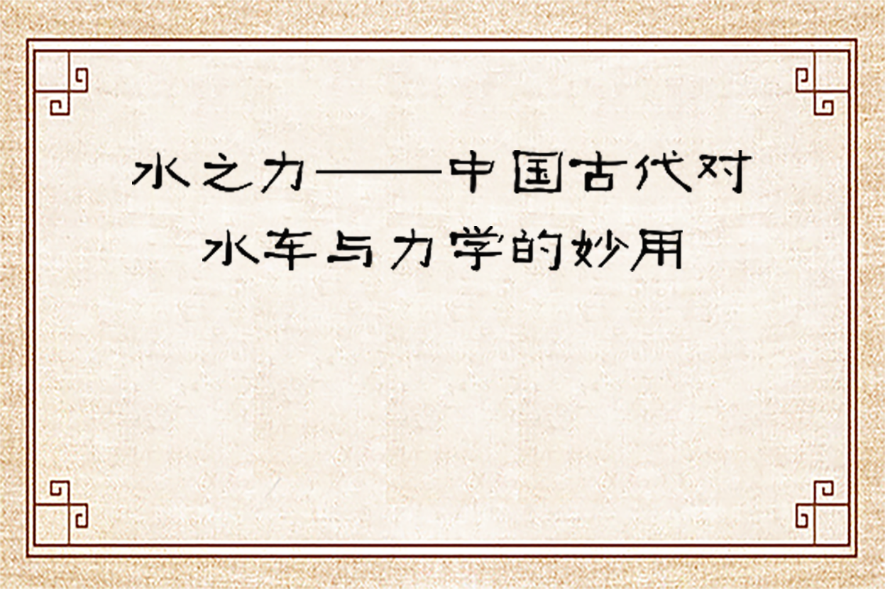
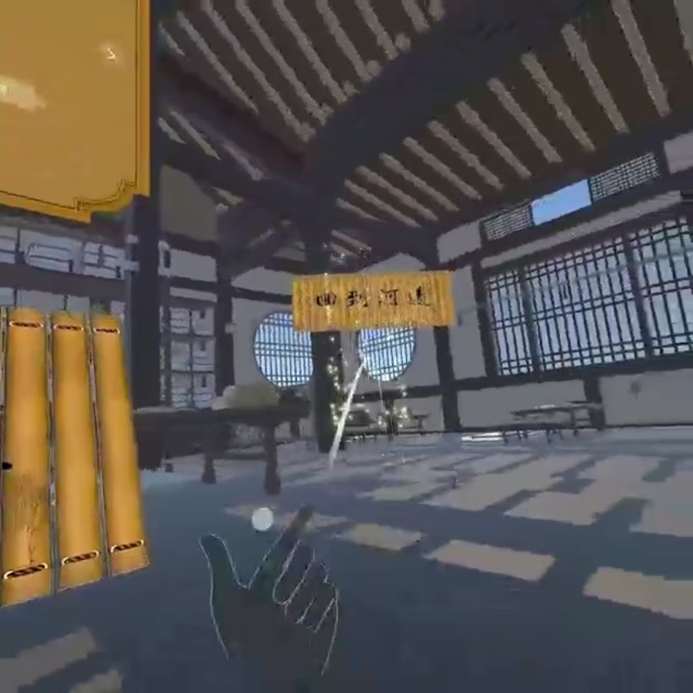
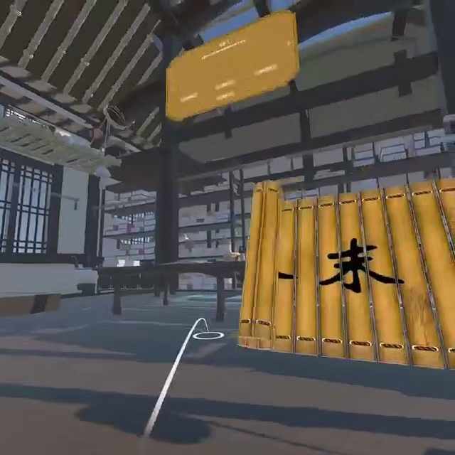
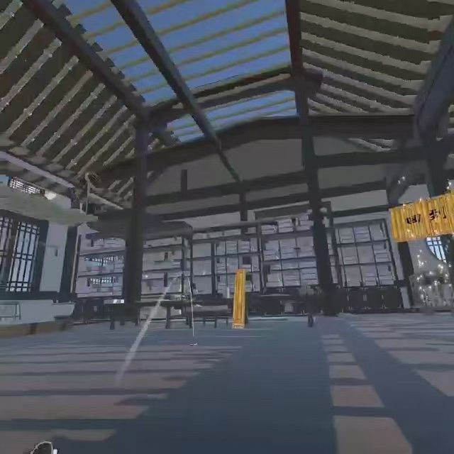
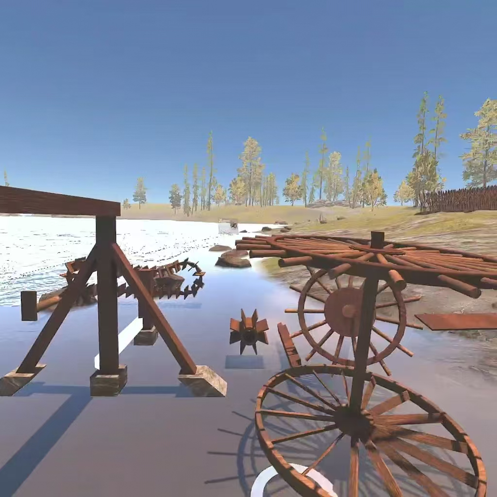
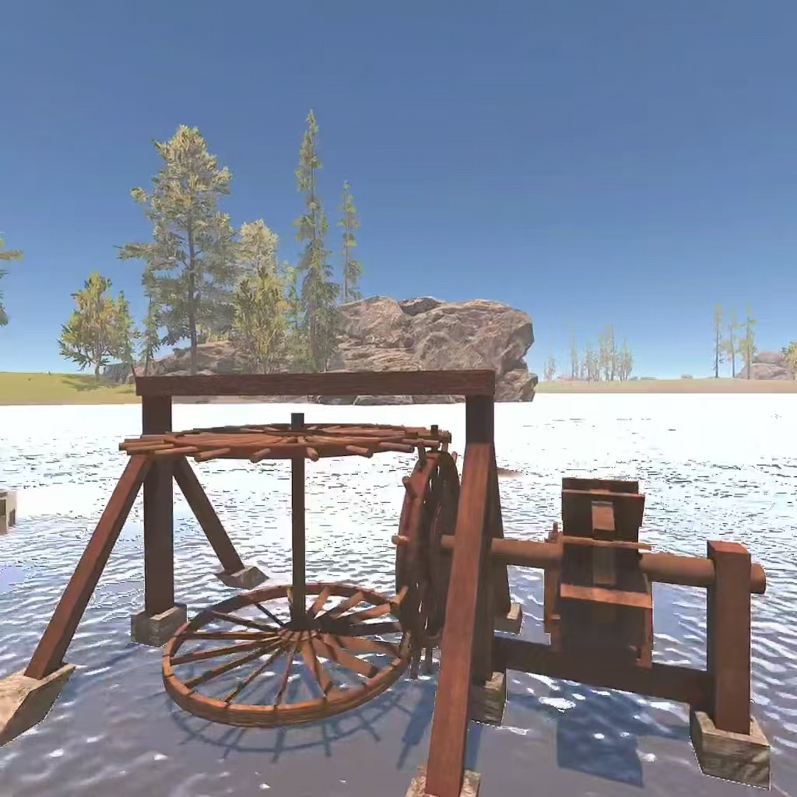
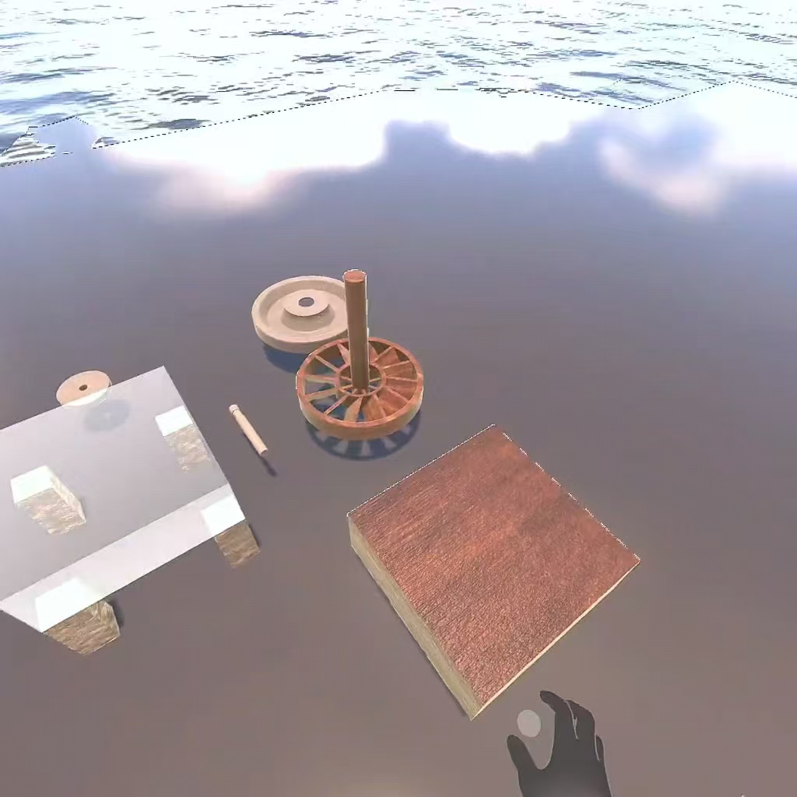
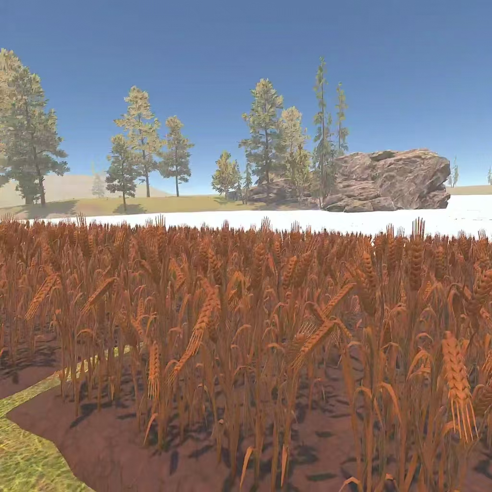
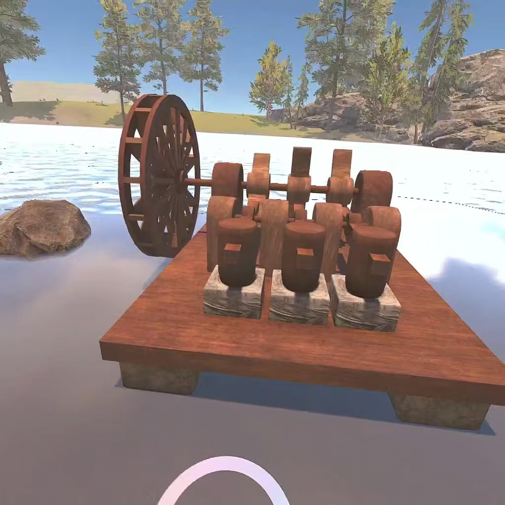
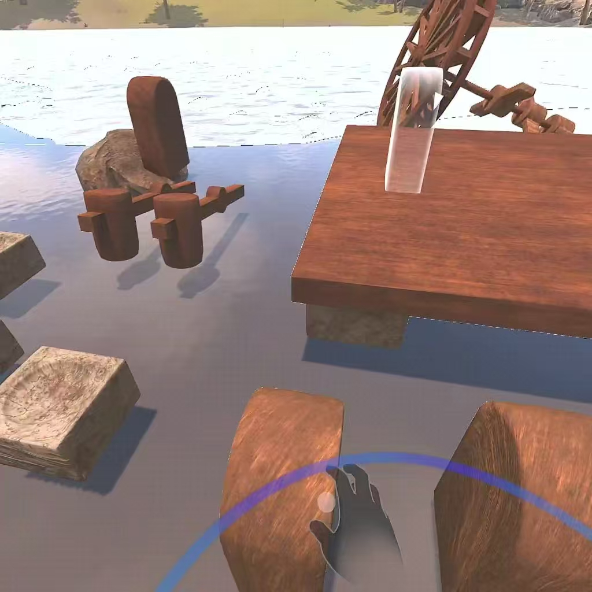

# 水之力：VR 古代水利结构拼装体验

一个面向 Meta Quest 3 的 VR 交互学习原型。项目以中国古代水利装置为主题，把结构观察、零件拼装和知识探索放进同一套空间体验中，让用户通过抓取、旋转、拖拽和对位，理解水车、水碓、水碾等装置如何借助水流产生机械运动。

## 项目亮点

- **结构化拼装**：将完整装置拆分为可交互零件，以装配顺序和透明定位提示引导用户完成组装。
- **装配结果反馈**：零件接近目标位置时提供对位反馈，完成后切换到整体运行展示，帮助用户把零件关系和运动结果联系起来。
- **双场景体验**：拼装场景强调动手探索，学堂场景通过交互面板、图文内容和知识问答补充历史与力学背景。
- **自然交互**：同时支持 VR 控制器和手部交互，覆盖抓取、释放、旋转、拖拽、按钮触发等基础操作。
- **沉浸式呈现**：使用古风建筑、农田与水流环境承载装置展示，配合 PBR 材质、动态水流和音效增强反馈。

## 主要流程

1. 进入场景并观察装置的整体结构。
2. 读取零件提示，按顺序抓取部件并移动到对应插槽。
3. 完成拼装后触发装置运行，观察水流、转动和传动关系。
4. 前往学堂场景查看装置背景，并通过知识问答完成复习。

## 技术实现

- Unity / C#
- Meta XR SDK、Meta Interaction SDK、OpenXR
- 组件化装配逻辑：`AssemblyPart`、`AssemblySocket`、`AssemblyStructure`、`AssemblyController`
- Maya 建模与 FBX 资产导入
- PBR 材质、Shader 高亮、动画与粒子/水流效果
- 面向 VR 的模型精度、LOD、资源加载和交互反馈优化

## 展示资源

- [演示视频（Release）](https://github.com/gouxiana/water-power-vr/releases/tag/v1.0-demo)
- [项目说明 PDF](water-power-overview.pdf)

### 游戏画面

| 场景 | 画面 |
| --- | --- |
| 入口与环境 |  |
| 学堂交互 |  |
| 装置展示 |  |
| 拼装过程 |  |
| 结构细节 |  |
| 运行效果 |  |
| 交互界面 |  |
| 场景探索 |  |
| 知识面板 |  |

## 构建与仓库边界

当前公开仓库聚焦项目展示，包含说明文档、截图和演示视频。Windows/VR 构建目录体积较大，未直接上传到仓库；完整 Unity 工程、签名配置和本地缓存也未公开。这样可以保留作品展示所需的信息，同时避免上传不必要的生成文件和本地环境配置。

## 体验环境

- Meta Quest 3 或兼容 OpenXR 的 VR 设备
- Windows PC + Unity 编辑环境
- 建议使用支持 OpenXR 的独立显卡设备运行展示构建

